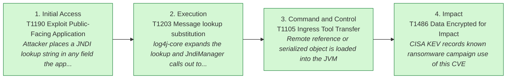

# Log4Shell (CVE-2021-44228): a logged string could make Java servers load attacker code

**Mode:** Patch-diff   **Analysed:** 2026-11-17   **Status:** Patched (upgrade to 2.17.1+, 2.12.4 or 2.3.2)

> Sample output generated with REA-Sec. Every fact below is from a public, primary source and the bug has been patched since December 2021. No exploit strings are included.

## TL;DR
Apache Log4j 2 expanded `${...}` lookups inside log messages, and its JNDI lookup would fetch objects from any LDAP server named in that string. Anyone who could get text into a log line could make the server reach out and load remote code. The fix first restricted JNDI (2.15.0), then disabled it by default and removed message lookups (2.16.0), with follow up hardening through 2.17.1.

## Timeline
| Date | Event | Status | Source |
|---|---|---|---|
| 2021-12-05 | Fix commit "Restrict LDAP access via JNDI (#608)", LOG4J2-3201, merged into apache/logging-log4j2 | CONFIRMED | [commit c77b3cb](https://github.com/apache/logging-log4j2/commit/c77b3cb39312b83b053d23a2158b99ac7de44dd3) |
| 2021-12-10 | CVE-2021-44228 published, CVSS 3.1 score 10.0 Critical | CONFIRMED | [NVD](https://nvd.nist.gov/vuln/detail/CVE-2021-44228) |
| 2021-12-10 | Added to CISA Known Exploited Vulnerabilities catalog, federal due date 2021-12-24, known ransomware use | CONFIRMED | [CISA KEV](https://www.cisa.gov/known-exploited-vulnerabilities-catalog) |
| 2021-12-14 | CVE-2021-45046 published: the 2.15.0 fix was incomplete in some non default configs (CVSS 9.0), fixed in 2.16.0 / 2.12.2 / 2.3.1 | CONFIRMED | [NVD](https://nvd.nist.gov/vuln/detail/CVE-2021-45046), [Apache](https://logging.apache.org/security.html) |
| 2021-12-18 | CVE-2021-45105 published: uncontrolled recursion in self referential lookups (CVSS 5.9), fixed in 2.17.0 | CONFIRMED | [NVD](https://nvd.nist.gov/vuln/detail/CVE-2021-45105) |
| 2021-12-28 | CVE-2021-44832 published: RCE via attacker controlled JDBC Appender config (CVSS 6.6), fixed in 2.17.1 / 2.12.4 / 2.3.2 | CONFIRMED | [NVD](https://nvd.nist.gov/vuln/detail/CVE-2021-44832) |

## Entry point
Any input an application logs with log4j-core 2.0-beta9 through 2.14.1: HTTP headers such as User-Agent, usernames, search fields, chat messages. No authentication needed (CVSS PR:N, UI:N). Source: [NVD](https://nvd.nist.gov/vuln/detail/CVE-2021-44228).

## Attack path (kill chain)
### Log4Shell (CVE-2021-44228) attack path

| # | Tactic | Technique | What happened | Status | Source |
|---|---|---|---|---|---|
| 1 | Initial Access | [T1190](https://attack.mitre.org/techniques/T1190/) Exploit Public-Facing Application | Attacker places a JNDI lookup string in any field the app logs (header, form field, username) | CONFIRMED | [link](https://nvd.nist.gov/vuln/detail/CVE-2021-44228) |
| 2 | Execution | [T1203](https://attack.mitre.org/techniques/T1203/) Message lookup substitution | log4j-core expands the lookup and JndiManager calls out to an attacker LDAP server | CONFIRMED | [link](https://github.com/apache/logging-log4j2/commit/c77b3cb39312b83b053d23a2158b99ac7de44dd3) |
| 3 | Command and Control | [T1105](https://attack.mitre.org/techniques/T1105/) Ingress Tool Transfer | Remote reference or serialized object is loaded into the JVM | CONFIRMED | [link](https://logging.apache.org/security.html) |
| 4 | Impact | [T1486](https://attack.mitre.org/techniques/T1486/) Data Encrypted for Impact | CISA KEV records known ransomware campaign use of this CVE | CONFIRMED | [link](https://www.cisa.gov/known-exploited-vulnerabilities-catalog) |



## Root cause
**CWE-917 Expression Language Injection, leading to CWE-502 Deserialization of Untrusted Data** (both listed by [NVD](https://nvd.nist.gov/vuln/detail/CVE-2021-44228)).

Vulnerable code path, in prose:
1. **Source:** untrusted text reaches a logger call, for example `logger.info("User-Agent: {}", ua)`.
2. **Expansion:** log4j-core's message lookup substitution scans the formatted message for `${prefix:...}` patterns and resolves them, including the `jndi` prefix. Data was treated as a template.
3. **Sink:** `JndiManager.lookup(name)` passed the attacker supplied name straight to `InitialContext.lookup()` with no restriction on protocol, host, or returned object type. An LDAP response could point to a remote class factory or carry a serialized Java object, which the JVM then loaded.

The missing check: nothing limited *where* JNDI could connect or *what* it could return.

## How the fix closes it
From [commit c77b3cb](https://github.com/apache/logging-log4j2/commit/c77b3cb39312b83b053d23a2158b99ac7de44dd3) (`log4j-core/.../net/JndiManager.java`):
- Switches from `Context` to `DirContext` so LDAP attributes can be inspected before anything is loaded.
- Adds allow lists: `allowedJndiProtocols` (default `java`, `ldap`, `ldaps`), `allowedLdapHosts` (default: local IPs only), `allowedLdapClasses` (default: Java primitive wrappers and `String`).
- `lookup()` now parses the name as a URI and returns `null` with a warning when the scheme or LDAP host is not allowed.
- If the LDAP entry carries `javaSerializedData` for a class not on the allow list, or a `javaReferenceAddress` / `javaFactory` (remote class loading), the lookup is refused.

That shipped in 2.15.0. Because message lookups still existed, CVE-2021-45046 showed the restriction could be sidestepped in non default Pattern Layouts using Thread Context lookups. 2.16.0 disabled JNDI by default and removed message lookups entirely ([Apache security page](https://logging.apache.org/security.html)). **Lesson:** the first patch narrowed the sink; the durable fix removed the feature that let data act as code.

## What was hit
Not a single breach: any internet facing Java app embedding a vulnerable log4j-core. Impact per NVD is full confidentiality, integrity and availability loss (C:H/I:H/A:H). CISA KEV records known ransomware campaign use.

## Confirmed vs unconfirmed
| Claim | Status | Source |
|---|---|---|
| Affects log4j-core 2.0-beta9 to 2.15.0 (excluding 2.12.2, 2.12.3, 2.3.1) | CONFIRMED | [NVD](https://nvd.nist.gov/vuln/detail/CVE-2021-44228) |
| log4j-api alone, log4net, log4cxx are not affected | CONFIRMED | [NVD](https://nvd.nist.gov/vuln/detail/CVE-2021-44228) |
| Exploited in the wild, including by ransomware operators | CONFIRMED | [CISA KEV](https://www.cisa.gov/known-exploited-vulnerabilities-catalog) |
| Setting `formatMsgNoLookups=true` alone fully protects you | NOT TRUE after CVE-2021-45046; upgrade instead | [Apache](https://logging.apache.org/security.html) |
| Your vendor's product is affected | UNKNOWN until checked against the vendor advisory or [CISA's affected software list](https://github.com/cisagov/log4j-affected-db) | INFERRED |

## Am I affected?
Run these only on systems you own:
- Maven: `mvn dependency:tree -Dincludes=org.apache.logging.log4j:log4j-core`
- Gradle: `gradle dependencyInsight --dependency log4j-core`
- Filesystem and fat JARs: search for `log4j-core-*.jar` and for `org/apache/logging/log4j/core/lookup/JndiLookup.class` inside JAR, WAR and EAR files.
- SBOM: query for `pkg:maven/org.apache.logging.log4j/log4j-core` with version below 2.17.1 (or below 2.12.4 on Java 7, 2.3.2 on Java 6).

## Detection
Sigma draft (shape of the attempt, not a working payload):

```yaml
title: Possible Log4Shell JNDI Lookup Attempt in Web Request
id: 7c1b5f0e-2f0a-4e4b-9a57-4c2d5f1e9b11
status: experimental
description: Detects JNDI lookup markers, including common obfuscation, in web request fields. See REA-Sec Log4Shell report.
references:
  - https://nvd.nist.gov/vuln/detail/CVE-2021-44228
author: REA-Sec draft
date: 2026-11-17
tags:
  - attack.initial-access
  - attack.t1190
  - cve.2021-44228
logsource:
  category: webserver
detection:
  selection_plain:
    - cs-uri-query|contains: '${jndi:'
    - cs-user-agent|contains: '${jndi:'
    - cs-referer|contains: '${jndi:'
  selection_obfuscated:
    - cs-uri-query|contains: '${${'
    - cs-user-agent|contains: '${${'
    - cs-user-agent|contains|all:
        - '${'
        - 'lower:'
  condition: 1 of selection_*
falsepositives:
  - Vulnerability scanners you run yourself
  - Security training traffic
level: high
```

Hunting ideas:
- Outbound LDAP (389, 636), RMI (1099) or DNS lookups from Java application servers to the internet, starting 2021-12-01. App servers rarely need these.
- Java processes spawning shells (`java` parent, `sh`, `bash`, `cmd.exe`, `powershell.exe` child): Sigma `process_creation`, ATT&CK T1059.
- Normalise and URL decode log fields before matching; attackers nested lookups to dodge simple string matches.

## Tonight
1. Inventory: run the dependency and JAR searches above across every repo, container image and server, and list each log4j-core below 2.17.1.
2. Upgrade to log4j-core 2.17.1 or later (2.12.4 for Java 7, 2.3.2 for Java 6). If you truly cannot, remove `JndiLookup.class` from the JAR as a stopgap per the [Apache security page](https://logging.apache.org/security.html).
3. Block outbound LDAP and RMI from app servers at the egress firewall, then run the hunting queries back to 2021-12-01.

## Unknowns
- Which of your third party appliances embed log4j-core. Check vendor advisories and CISA's list.
- Whether a historical compromise left persistence. Old logs may be gone; check for unexpected accounts, scheduled tasks and web shells on hosts that were exposed.

## Sources
- NVD, CVE-2021-44228: https://nvd.nist.gov/vuln/detail/CVE-2021-44228
- NVD, CVE-2021-45046: https://nvd.nist.gov/vuln/detail/CVE-2021-45046
- NVD, CVE-2021-45105: https://nvd.nist.gov/vuln/detail/CVE-2021-45105
- NVD, CVE-2021-44832: https://nvd.nist.gov/vuln/detail/CVE-2021-44832
- Apache Logging Services security page: https://logging.apache.org/security.html
- Fix commit c77b3cb: https://github.com/apache/logging-log4j2/commit/c77b3cb39312b83b053d23a2158b99ac7de44dd3
- GitHub Advisory GHSA-jfh8-c2jp-5v3q: https://github.com/advisories/GHSA-jfh8-c2jp-5v3q
- CISA KEV catalog: https://www.cisa.gov/known-exploited-vulnerabilities-catalog
- CISA Log4j affected software list: https://github.com/cisagov/log4j-affected-db

---

## Operator Ticket version

```
One logging library put half the internet one string away from remote code execution.

What is on the record:
- 2021-12-10 NVD published CVE-2021-44228 (Log4Shell), CVSS 10.0.
- 2021-12-10 CISA added it to the KEV catalog, with known ransomware use.
- 2021-12-14 NVD published CVE-2021-45046 after the first fix in 2.15.0 proved incomplete.

Tonight:
1. Run your SBOM or mvn dependency:tree and find every log4j-core below 2.17.1.
2. Upgrade to 2.17.1 or later (2.12.4 for Java 7, 2.3.2 for Java 6).
3. Block outbound LDAP and RMI from app servers, then hunt logs for ${jndi: since 2021-12-01.

Still finding log4j-core 2.14 in your containers?
```
