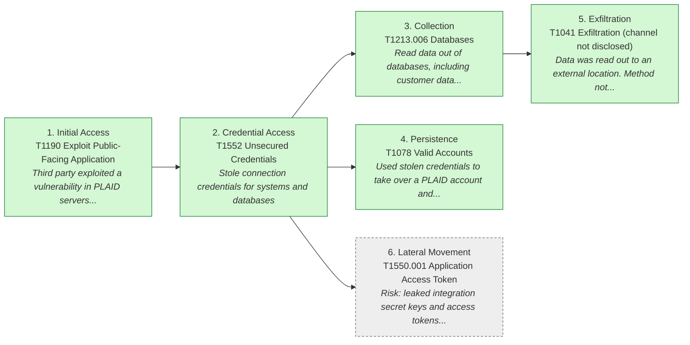

# PLAID KARTE breach: one SaaS server bug exposed customer data and integration keys across Japanese brands

**Mode:** Breach   **Analysed:** 2026-11-17   **Status:** Contained (KARTE offline, restart date undecided)

> Sample output generated by following REA-Sec's SKILL.md on public notices. All sources are in Japanese. Key figures quote the original wording, followed by an English translation. Only facts stated by PLAID or the affected companies are included. The vulnerability has not been publicly named, so this report does not guess at it.

## TL;DR
On 13 Nov 2026 an attacker exploited a vulnerability in servers run by PLAID, the company behind the KARTE customer experience platform. The attacker stole database connection credentials, read data out, and took over a PLAID admin account. PLAID confirmed on 16 Nov that the stolen data included 79,249 account email addresses, the secret keys and tokens that customers use to connect KARTE to other services, and some customer member data. Downstream brands are now disclosing: up to about 2.6M Ainz & Tulpe and AYURA members, up to 331,586 records at Hankyu Hanshin Hotels, and member data at World Co. (count still being checked).

## Timeline
All times are JST, as stated by the source.

| Date | Event | Status | Source |
|---|---|---|---|
| 2026-11-13, early morning | A third party exploited a vulnerability in PLAID servers, stole system and database connection credentials, and read data out of databases. The stolen credentials were then used to take over a PLAID account and access the admin console. | CONFIRMED | [PLAID](https://plaid.co.jp/news/20261116/) |
| 2026-11-13 08:59 | PLAID detected the intrusion and began invalidating the stolen credentials | CONFIRMED | [PLAID](https://plaid.co.jp/news/20261116/) |
| 2026-11-13 ~14:27 | PLAID began shutting down servers and put all KARTE services into maintenance mode | CONFIRMED | [PLAID](https://plaid.co.jp/news/20261116/) |
| 2026-11-13 ~15:23 | Containment done: credentials invalidated and attacker traffic blocked. PLAID says no new unauthorised access has been seen since. | CONFIRMED | [PLAID](https://plaid.co.jp/news/20261116/) |
| 2026-11-13 | PLAID published its first notice about the unauthorised access | CONFIRMED | [PLAID](https://plaid.co.jp/news/20261116/) (refers to the 11-13 notice) |
| 2026-11-15 | PLAID told Ainz & Tulpe and Hankyu Hanshin Hotels that their customer data was affected | CONFIRMED | [Ainz & Tulpe](https://ainz-tulpe.jp/blogs/information/%E3%82%A2%E3%82%A4%E3%83%B3%E3%82%BA-%E3%83%88%E3%83%AB%E3%83%9A%E5%85%AC%E5%BC%8F%E3%82%A2%E3%83%97%E3%83%AA%E5%8F%8A%E3%81%B3%E5%85%AC%E5%BC%8F%E3%82%AA%E3%83%B3%E3%83%A9%E3%82%A4%E3%83%B3%E3%82%B9%E3%83%88%E3%82%A2%E3%81%AB%E3%81%8A%E3%81%91%E3%82%8B-%E3%81%8A%E5%AE%A2%E3%81%95%E3%81%BE%E6%83%85%E5%A0%B1%E6%B5%81%E5%87%BA%E3%81%AE%E5%8F%AF%E8%83%BD%E6%80%A7%E3%81%AB%E3%81%A4%E3%81%84%E3%81%A6), [Hankyu Hanshin Hotels](https://www.hankyu-hotel.com/topics/2026/GPDetailPage) |
| 2026-11-16 | PLAID confirmed the leak, began contacting affected customers, and is reporting to Japan's Personal Information Protection Commission and consulting police | CONFIRMED | [PLAID](https://plaid.co.jp/news/20261116/) |
| 2026-11-16 | Hankyu Hanshin Hotels disclosed up to 331,586 records, mainly Members Club members | CONFIRMED | [Hankyu Hanshin Hotels](https://www.hankyu-hotel.com/topics/2026/GPDetailPage) |
| 2026-11-17 | World Co. disclosed that member data for World Online Store and its subsidiary Tin Pan Alley was affected | CONFIRMED | [World Co.](https://corp.world.co.jp/news/company/2026/15602/) |
| 2026-11-17 | Ainz & Tulpe disclosed up to about 2.6M member records (Ainz & Tulpe and AYURA members) | CONFIRMED | [Ainz & Tulpe](https://ainz-tulpe.jp/blogs/information/%E3%82%A2%E3%82%A4%E3%83%B3%E3%82%BA-%E3%83%88%E3%83%AB%E3%83%9A%E5%85%AC%E5%BC%8F%E3%82%A2%E3%83%97%E3%83%AA%E5%8F%8A%E3%81%B3%E5%85%AC%E5%BC%8F%E3%82%AA%E3%83%B3%E3%83%A9%E3%82%A4%E3%83%B3%E3%82%B9%E3%83%88%E3%82%A2%E3%81%AB%E3%81%8A%E3%81%91%E3%82%8B-%E3%81%8A%E5%AE%A2%E3%81%95%E3%81%BE%E6%83%85%E5%A0%B1%E6%B5%81%E5%87%BA%E3%81%AE%E5%8F%AF%E8%83%BD%E6%80%A7%E3%81%AB%E3%81%A4%E3%81%84%E3%81%A6) |

## Entry point
**An unnamed vulnerability in PLAID's servers. No CVE has been disclosed.** PLAID: 「当社サーバーの脆弱性を悪用して」 ("by exploiting a vulnerability in our servers"). [Source](https://plaid.co.jp/news/20261116/). Whether the bug was in PLAID's own code or a third party component has not been disclosed.

## Attack path (kill chain)
### PLAID KARTE breach (Nov 2026) attack path

| # | Tactic | Technique | What happened | Status | Source |
|---|---|---|---|---|---|
| 1 | Initial Access | [T1190](https://attack.mitre.org/techniques/T1190/) Exploit Public-Facing Application | Third party exploited a vulnerability in PLAID servers early on 13 Nov JST. CVE not disclosed | CONFIRMED | [link](https://plaid.co.jp/news/20261116/) |
| 2 | Credential Access | [T1552](https://attack.mitre.org/techniques/T1552/) Unsecured Credentials | Stole connection credentials for systems and databases | CONFIRMED | [link](https://plaid.co.jp/news/20261116/) |
| 3 | Collection | [T1213.006](https://attack.mitre.org/techniques/T1213/006/) Databases | Read data out of databases, including customer data imported via the linking table feature | CONFIRMED | [link](https://plaid.co.jp/news/20261116/) |
| 4 | Persistence | [T1078](https://attack.mitre.org/techniques/T1078/) Valid Accounts | Used stolen credentials to take over a PLAID account and access the admin console | CONFIRMED | [link](https://plaid.co.jp/news/20261116/) |
| 5 | Exfiltration | [T1041](https://attack.mitre.org/techniques/T1041/) Exfiltration (channel not disclosed) | Data was read out to an external location. Method not disclosed | CONFIRMED | [link](https://plaid.co.jp/news/20261116/) |
| 6 | Lateral Movement | [T1550.001](https://attack.mitre.org/techniques/T1550/001/) Application Access Token | Risk: leaked integration secret keys and access tokens could be used against connected services. No abuse confirmed | INFERRED | [link](https://plaid.co.jp/news/20261116/) |



## Root cause
Not disclosed. PLAID says it will publish preventive measures after an external forensic investigation ([source](https://plaid.co.jp/news/20261116/)). INFERRED: the attacker could reach database and system connection credentials from a server they had compromised, so the credentials were not isolated from the internet facing tier. This is analysis, not a stated fact.

## What was hit
PLAID's confirmed list as of 2026-11-16 ([source](https://plaid.co.jp/news/20261116/)):
1. KARTE account email addresses: 「79,249件」 (79,249 addresses).
2. Credentials customers use to connect KARTE to external services: 「シークレットキー、アクセストークン等」 (secret keys, access tokens and similar). Count still under investigation.
3. Part of the customer data that client companies imported into KARTE, such as member data loaded through the 「紐付けテーブル」 (linking table) feature. Each client chooses which fields it imports, so this may include personal data. Count still under investigation.

## Downstream disclosures
| Company | Disclosed | Scope | Data types | Explicitly NOT hit | Source |
|---|---|---|---|---|---|
| Ainz & Tulpe (incl. AYURA) | 2026-11-17 | 「最大約260万件」 (up to about 2.6M member records) | Name, date of birth, gender, email, phone | Credit card data, login passwords | [notice](https://ainz-tulpe.jp/blogs/information/%E3%82%A2%E3%82%A4%E3%83%B3%E3%82%BA-%E3%83%88%E3%83%AB%E3%83%9A%E5%85%AC%E5%BC%8F%E3%82%A2%E3%83%97%E3%83%AA%E5%8F%8A%E3%81%B3%E5%85%AC%E5%BC%8F%E3%82%AA%E3%83%B3%E3%83%A9%E3%82%A4%E3%83%B3%E3%82%B9%E3%83%88%E3%82%A2%E3%81%AB%E3%81%8A%E3%81%91%E3%82%8B-%E3%81%8A%E5%AE%A2%E3%81%95%E3%81%BE%E6%83%85%E5%A0%B1%E6%B5%81%E5%87%BA%E3%81%AE%E5%8F%AF%E8%83%BD%E6%80%A7%E3%81%AB%E3%81%A4%E3%81%84%E3%81%A6) |
| Hankyu Hanshin Hotels | 2026-11-16 | 「計331,586件」 (331,586 records), mainly Members Club | Name, age, address, phone, email and other items; hotel stay history may be included (being checked) | Credit card data, passport data | [notice](https://www.hankyu-hotel.com/topics/2026/GPDetailPage) |
| World Co. (World Online Store, Tin Pan Alley) | 2026-11-17 | Some member data. Items and counts being checked. | Not yet stated | Not yet stated | [notice](https://corp.world.co.jp/news/company/2026/15602/) |

Members may appear in more than one company's data, so these figures should not be added together as a count of unique people.

## Confirmed vs unconfirmed
| Claim | Status | Source |
|---|---|---|
| The entry point was a vulnerability in PLAID's servers | CONFIRMED | [PLAID](https://plaid.co.jp/news/20261116/) |
| Which vulnerability or CVE | UNKNOWN | Not disclosed |
| Integration secrets (keys, tokens) leaked | CONFIRMED | [PLAID](https://plaid.co.jp/news/20261116/) |
| Leaked integration secrets were used against connected services | UNCONFIRMED. PLAID warns this could lead to unintended data writes or leaks if the secrets are not revoked. | [PLAID](https://plaid.co.jp/news/20261116/) |
| No new unauthorised access since containment on 2026-11-13 | CONFIRMED (PLAID's statement) | [PLAID](https://plaid.co.jp/news/20261116/) |
| Ainz & Tulpe's own app and online store are unaffected and still operating (they run on a separate system) | CONFIRMED | [Ainz & Tulpe](https://ainz-tulpe.jp/blogs/information/%E3%82%A2%E3%82%A4%E3%83%B3%E3%82%BA-%E3%83%88%E3%83%AB%E3%83%9A%E5%85%AC%E5%BC%8F%E3%82%A2%E3%83%97%E3%83%AA%E5%8F%8A%E3%81%B3%E5%85%AC%E5%BC%8F%E3%82%AA%E3%83%B3%E3%83%A9%E3%82%A4%E3%83%B3%E3%82%B9%E3%83%88%E3%82%A2%E3%81%AB%E3%81%8A%E3%81%91%E3%82%8B-%E3%81%8A%E5%AE%A2%E3%81%95%E3%81%BE%E6%83%85%E5%A0%B1%E6%B5%81%E5%87%BA%E3%81%AE%E5%8F%AF%E8%83%BD%E6%80%A7%E3%81%AB%E3%81%A4%E3%81%84%E3%81%A6) |
| Who the attacker is | UNKNOWN | No attribution in any primary source |
| Total number of affected KARTE client companies | UNKNOWN | PLAID is contacting clients individually |

## Am I affected?
- **If you are a KARTE client:** check for PLAID's individual notice. List every external integration configured in the KARTE admin console (PLAID names this as the affected scope), and list which fields you loaded through the linking table.
- **If you are a member of an affected brand:** follow that brand's notice. Expect phishing that impersonates the brand or PLAID (PLAID, Ainz & Tulpe and Hankyu Hanshin Hotels all warn about this).

## Detection
Draft 1: leaked integration keys used from outside the expected source (AWS example; adapt it to whichever services KARTE connected to).
```yaml
title: KARTE Integration Credential Used From Unexpected Source After 2026-11-13
id: 3f6a1c52-9d7e-4b8a-a1f4-6c2e0d9b7a10
status: experimental
description: Calls made with the IAM user or access key that KARTE used for integrations, from IPs outside the vendor's documented ranges. See the REA-Sec PLAID KARTE report.
references:
  - https://plaid.co.jp/news/20261116/
author: REA-Sec draft
date: 2026-11-17
tags:
  - attack.lateral-movement
  - attack.t1550.001
  - attack.t1078
logsource:
  product: aws
  service: cloudtrail
detection:
  selection:
    userIdentity.userName: 'karte-integration'   # replace with your integration principal
  filter_known:
    sourceIPAddress|cidr:
      - '192.0.2.0/24'                          # replace with the vendor's documented egress ranges
  condition: selection and not filter_known
falsepositives:
  - Vendor egress IP changes during service restoration
level: high
```

Draft 2: lure emails that use the breach as a pretext.
```yaml
title: Inbound Email Referencing KARTE or PLAID From Non-Vendor Domain
id: 8b2d4e71-0c5a-4f9e-b3d6-1a7c9e2f4b55
status: experimental
description: PLAID, Ainz & Tulpe and Hankyu Hanshin Hotels warn of suspicious contact using this incident. Needs an email gateway log source mapped to Sigma.
references:
  - https://plaid.co.jp/news/20261116/
  - https://ainz-tulpe.jp/blogs/information/%E3%82%A2%E3%82%A4%E3%83%B3%E3%82%BA-%E3%83%88%E3%83%AB%E3%83%9A%E5%85%AC%E5%BC%8F%E3%82%A2%E3%83%97%E3%83%AA%E5%8F%8A%E3%81%B3%E5%85%AC%E5%BC%8F%E3%82%AA%E3%83%B3%E3%83%A9%E3%82%A4%E3%83%B3%E3%82%B9%E3%83%88%E3%82%A2%E3%81%AB%E3%81%8A%E3%81%91%E3%82%8B-%E3%81%8A%E5%AE%A2%E3%81%95%E3%81%BE%E6%83%85%E5%A0%B1%E6%B5%81%E5%87%BA%E3%81%AE%E5%8F%AF%E8%83%BD%E6%80%A7%E3%81%AB%E3%81%A4%E3%81%84%E3%81%A6
author: REA-Sec draft
date: 2026-11-17
tags:
  - attack.initial-access
  - attack.t1566
logsource:
  category: email            # custom mapping for your mail gateway
detection:
  selection_topic:
    subject|contains:
      - 'KARTE'
      - 'プレイド'
      - '情報漏えい'
      - '情報流出'
  filter_vendor:
    sender_domain|endswith:
      - 'plaid.co.jp'
  condition: selection_topic and not filter_vendor
falsepositives:
  - Newsletters and press coverage of the breach
  - Your own customer notifications (add your sending domains to the filter)
level: medium
```

Hunting:
- For every service that KARTE connected to (MA tools, CRMs, data warehouses, messaging APIs), pull audit logs from 2026-11-13 00:00 JST onwards for calls made with the KARTE integration credential. Look for bulk reads, new webhooks, or writes the vendor would not make.
- Confirm that each revoked key now returns auth failures. Successful calls after the revocation time mean a key was missed.

## Tonight
1. Revoke and reissue every secret key, access token and webhook secret configured in KARTE integrations. PLAID explicitly asks clients to do this, and warns that unrevoked keys could allow data to be written to or leaked from connected services. Then run the audit log hunt back to 2026-11-13.
2. Export the list of fields you loaded into KARTE's linking table and treat that data as exposed. Brief legal on notification duties under Japan's personal information law (APPI); the PPC is already involved on PLAID's side.
3. Warn customers and staff about phishing that uses this breach. Block lookalike domains of your brand and of PLAID, and move your sending domains to DMARC p=reject so your own notices cannot be spoofed.

## Unknowns
- Which vulnerability was exploited, and whether it was in PLAID's own code or a component (would be confirmed by PLAID's forensic report).
- How many client companies' integration secrets leaked, and whether any were abused before revocation.
- Final record counts at World Co., and the count for PLAID's linking table data.
- When KARTE will restart ([PLAID](https://plaid.co.jp/news/20261116/): 「現時点では未定」, "undecided at this time").

## Sources
- PLAID, notice of 2026-11-16 (Japanese): https://plaid.co.jp/news/20261116/
- World Co., notice of 2026-11-17 (Japanese): https://corp.world.co.jp/news/company/2026/15602/
- Ainz & Tulpe, notice of 2026-11-17 (Japanese): https://ainz-tulpe.jp/blogs/information/%E3%82%A2%E3%82%A4%E3%83%B3%E3%82%BA-%E3%83%88%E3%83%AB%E3%83%9A%E5%85%AC%E5%BC%8F%E3%82%A2%E3%83%97%E3%83%AA%E5%8F%8A%E3%81%B3%E5%85%AC%E5%BC%8F%E3%82%AA%E3%83%B3%E3%83%A9%E3%82%A4%E3%83%B3%E3%82%B9%E3%83%88%E3%82%A2%E3%81%AB%E3%81%8A%E3%81%91%E3%82%8B-%E3%81%8A%E5%AE%A2%E3%81%95%E3%81%BE%E6%83%85%E5%A0%B1%E6%B5%81%E5%87%BA%E3%81%AE%E5%8F%AF%E8%83%BD%E6%80%A7%E3%81%AB%E3%81%A4%E3%81%84%E3%81%A6
- Hankyu Hanshin Hotels, notice of 2026-11-16 (Japanese): https://www.hankyu-hotel.com/topics/2026/GPDetailPage

---

## Operator Ticket version
```
One SaaS bug in Japan just leaked the keys to its customers' other systems.

What is on the record:
- 2026-11-16 PLAID said an attacker exploited a vulnerability in its servers and stole integration secret keys and tokens.
- 2026-11-16 Hankyu Hanshin Hotels said up to 331,586 records leaked via KARTE.
- 2026-11-17 Ainz & Tulpe said up to about 2.6M member records may have leaked.

Tonight:
1. Revoke and reissue every key and token you connected to KARTE.
2. Hunt audit logs on those services back to 13 Nov.
3. Set DMARC p=reject and warn customers about breach-themed phishing.

Which of your SaaS tools holds keys to everything else?
```
